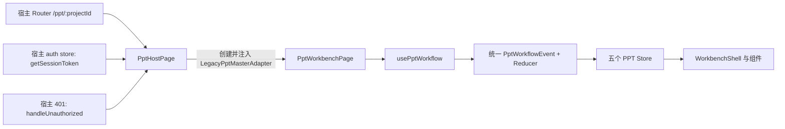

# AI 全能盒子 PPT 工作台宿主接入报告

日期：2026-07-18

宿主目录：`/home/youyeetoo/INnet_agent/web/`

PPT 来源基线：`D:\中科信创\PPT前端\ppt-workbench-vue-blueprint`，`main@82a4ed4`，标签 `legacy-integration-baseline-20260718`

## 1. 版本与回滚基线

| 项目 | 版本 |
|---|---|
| 宿主接入前原始 `main` | `aa32899f53df0752187072df16a61764dc861b3f` |
| 宿主未提交修改快照 | `3a7763a` |
| 回滚分支 | `backup/pre-ppt-host-integration-20260718` |
| 回滚标签 | `pre-ppt-host-integration-20260718` |
| PPT 宿主功能提交 | `e9cc1a2` (`feat: integrate ppt workbench into ai office host`) |
| 接入分支 | `feat/ppt-workbench-host-integration` |
| 计划合并标签 | `ppt-workbench-host-baseline-20260718` |

宿主开始时存在未提交修改，已完整提交为独立快照后再创建功能分支，因此没有覆盖或丢弃既有工作。原宿主快照中的三个语法缺陷会阻止构建，接入中仅做了最小修复：`ChatPage.vue` 多余右花括号、`DocumentPage.vue` 缺失按钮起始标签、`AgentDirectoryPage.vue` 多余右花括号。

## 2. 接入结果

PPT 工作台已作为宿主的单一业务 feature 接入，而不是第二套 Vue 应用。生产入口默认创建 `LegacyPptMasterAdapter`，开发与契约测试继续保留 `MockPptWorkflowAdapter`。独立项目的 `App.vue`、`main.ts`、Router、Pinia、JWT 输入页、全局 CSS 重置、环境 Token、构建产物和验收临时文件均未迁入。

保留的产品与架构能力包括：

- `conversation → opening → split-workbench` 页面状态转换；
- `workspaceMode`、`workflowStage`、`activeView`、`selectedSlideId` 职责分离；
- 五个 PPT Pinia Store、统一 `PptWorkflowEvent`、Reducer 和 sequence/任务隔离保护；
- Mock、Legacy、HTTP 三种 Adapter 及能力声明；
- Legacy POST SSE、幂等 request ID、规范化错误、鉴权 Blob 下载；
- 项目会话和工作区恢复；
- Legacy 无逐页数据时的诚实能力说明，不伪造缩略图或在线编辑能力。

## 3. 修改文件清单

### 新增

- `src/features/ppt-workbench/`：完整 PPT feature（44 个源码文件），包括 adapters、components、composables、pages、persistence、protocol、stores、types、utils 和 feature 局部样式。
- `src/views/PptHostPage.vue`：宿主认证、配置、Adapter 创建和工作台注入边界。
- `src/vite-env.d.ts`、`tsconfig.json`：宿主 TypeScript/Vue 类型检查配置。
- `tests/`：PPT 工作流、Legacy 契约、下载、SSE、持久化、宿主接入和 UUID 降级测试。
- `docs/evidence/`：真实浏览器验收截图。
- `docs/superpowers/specs/2026-07-18-ppt-workbench-host-integration-design.md`
- `docs/superpowers/plans/2026-07-18-ppt-workbench-host-integration.md`

### 修改

- `src/main.js`：向宿主现有 Router 注册 `/ppt` 和 `/ppt/:projectId`；未创建第二个 Router 或 Pinia。
- `src/views/WelcomePage.vue`、`ChatPage.vue`、`DocumentPage.vue`：按各自既有导航样式新增“PPT 生成”入口。
- `src/views/AgentDirectoryPage.vue`：修复接入前快照中的阻断构建语法错误。
- `package.json`、`package-lock.json`：加入 PPT 测试和类型检查工具及脚本。
- `vite.config.js`：复用现有 `/api` 代理并加入 Vitest 配置。
- `.env.example`：记录可选 PPT 后端地址，不包含 JWT 或密码。

## 4. 导航与路由

| 入口 | 行为 |
|---|---|
| `/ppt` | 生成新的前端项目 ID，并重定向到 `/ppt/:projectId` |
| `/ppt/:projectId` | 打开或恢复对应 PPT 会话和工作台状态 |
| Welcome / Chat / Document 导航 | 使用宿主现有图标尺寸、字体、颜色和选中态增加“PPT 生成” |

项目 ID 优先使用 `crypto.randomUUID()`，在内网 HTTP 非安全上下文下降级生成合法 UUID v4，避免因 Web Crypto 不可用导致入口白屏。返回相同项目路由后，可恢复消息、工作台模式、活动视图、选中页和面板状态。

## 5. Pinia、Router 与 KeepAlive

- 宿主仍只在 `src/main.js` 调用一次 `createPinia()` 和一次 `createRouter()`。
- PPT 五个 Store 使用宿主 Pinia 的 active context，未维护第二个 Store 容器。
- PPT 路由直接加入宿主 Router，不覆盖 `main.ts` 或现有路由。
- 当前宿主未为这些页面配置统一 KeepAlive；PPT 通过既有 session/workspace persistence 在路由重建或刷新时恢复，未改变 Chat、Word 或知识库的缓存策略。

五个 Store 职责：

| Store | 职责 |
|---|---|
| `pptConversation` | 用户/助手消息、任务阶段卡和结果入口 |
| `pptGeneration` | 当前任务、后台阶段、进度、顺序保护和验证/导出结果 |
| `pptProject` | PPT 领域项目、brief、outline、slides、theme 和提案应用结果 |
| `pptWorkspace` | `workspaceMode`、`activeView`、选中页、面板尺寸/折叠和恢复 |
| `pptUi` | feature 范围内的 UI 状态与提示，不替代宿主全局认证/消息机制 |

## 6. JWT 与 Adapter 注入



- Token 只通过宿主 `getSessionToken()` getter 按请求获取；PPT Store 和 localStorage 不保存第二份 Token。
- 401 调用宿主 `handleUnauthorized()`，沿用宿主 `mqw-auth-expired` 重新登录链路。
- `WorkbenchShell` 不 import、创建或按名称判断任何具体 Adapter。
- 下载继续使用带 Bearer 的 `fetch` 获取 Blob，再创建临时对象 URL；不暴露裸下载链接。
- 浏览器页面、DOM、截图、报告和测试输出均未包含 JWT。

## 7. 环境与 HTTP

```dotenv
# Optional cross-origin override. Empty uses the host's existing /api proxy.
VITE_PPT_MASTER_BASE_URL=
```

生产默认复用宿主同源 `/api` 代理，避免为同机服务新增重复地址及跨域下载问题。确需跨域部署时可设置 `VITE_PPT_MASTER_BASE_URL`。本次内网 HTTP 联调使用 `VITE_PPT_MASTER_PAGE_COUNT=1` 作为受控开发参数；生产缺省页数仍为 8。

内网 HTTP 非安全上下文中 `crypto.subtle` 不可用，因此 SHA-256 下载复核按契约作为可选项跳过；文件大小校验仍强制执行。HTTPS/安全上下文会自动启用 SHA-256 校验。

## 8. 样式冲突处理

- 只迁入 `src/features/ppt-workbench/ppt-workbench.css` 中的 `.ppt-*` 作用域规则、动画和响应式规则。
- 未迁入独立项目对 `body`、`button`、`input` 等标签的全局重置。
- conversation 落地页位于宿主内容区域内，不渲染第二套全局侧边栏。
- 窄屏横向滚动仍是临时响应式兜底，不声明为豆包真实移动端方案。

## 9. Legacy 能力与事件映射

| 原始事件 | 规范事件/结果 | UI |
|---|---|---|
| `progress` | `stage.changed` / `progress.updated` | 中文阶段卡，不透传原始英文 message |
| `spec` | `design.ready` | 设计方案状态 |
| `validate` | `validation.completed` | 通过、警告、错误和阻断项 |
| `done` | `export.ready` → `task.completed` | PPTX 下载主操作 |
| `fallback` | `task.failed` | 规范化失败提示 |

能力声明保持：`fileDownload=true`；`incrementalOutline`、`incrementalSlides`、`taskCancellation`、`taskResume`、`slideRegeneration`、`proposalApply` 均为 `false`。Legacy 生成期间只展示一次性任务骨架，占位数量来自请求 `page_count`，不写入真实 `pptProject.slides`；完成后无逐页数据时禁用编辑器并提示“等待逐页数据”，不显示“0 页内容可用”。

## 10. 真实 1 页宿主联调

联调条件：正常业务账号、`page_count=1`、`page_format=ppt169`、`sources=[]`、新 request ID。所有证据已脱敏。

| 验证项 | 结果 |
|---|---|
| 从宿主导航进入 `/ppt/:projectId` | 通过 |
| conversation 首屏、提交后 opening、split-workbench | 通过 |
| JWT 使用宿主认证链路 | 通过 |
| SSE 完整结束、无解析异常 | 通过 |
| 中文阶段卡 | 通过：分析、设计、生成、质检、导出 |
| Legacy 能力边界 | 通过：1 个骨架占位、0 个伪造 Slide、编辑器禁用 |
| 鉴权 Blob 下载 | 通过；后端下载响应 200，页面显示下载成功 |
| 下载大小 | 14,359 bytes，与后端记录一致 |
| PPTX OOXML | ZIP 正常，必需 OOXML 部件齐全，1 张 Slide |
| 可编辑性 | 检出 42 个可编辑 shape、16 个文本 run |
| 项目刷新恢复 | 通过：消息、阶段卡、结果卡和工作台恢复 |
| Chat / Word / 知识库入口 | 通过，切换后返回 PPT 状态仍在 |
| 最终干净浏览器会话 | 控制台 0 error、0 warning |
| JWT/服务器文件路径泄露 | 未发现 |

浏览器自动化未取得 object URL 的下载事件句柄；下载成功由页面成功状态、服务端带鉴权 GET 200、文件大小一致以及下载文件 OOXML/可编辑结构检查共同证明。

## 11. 浏览器证据

1. [conversation 落地页](docs/evidence/01-ppt-conversation-landing.png)
2. [opening 展开过程](docs/evidence/02-ppt-opening.png)
3. [Legacy 真实生成](docs/evidence/03-ppt-legacy-generating.png)
4. [Legacy 完成与下载](docs/evidence/04-ppt-legacy-completed.png)
5. [质量检查结果](docs/evidence/05-ppt-validation.png)

## 12. 自动验证

| 命令 | 结果 |
|---|---|
| `npm test` | 宿主 Node 测试 15/15；Vitest 13 文件、96/96 |
| `npm run typecheck` | 通过 |
| `npm run build` | 通过；Vite 5.4，2216 modules transformed |

覆盖包括：宿主路由/导航/单 Router 与 Pinia、Mock 与 Legacy 统一入口、SSE 跨 chunk/flush、请求幂等、HTTP 状态映射、鉴权 Blob 下载、Legacy UX、工作区恢复、activeView 不被后台事件抢占和 HTTP UUID 降级。

`npm install` 后审计仍报告 7 个依赖漏洞（3 moderate、2 high、2 critical），本阶段未使用可能引入破坏性升级的自动修复；应作为独立依赖治理任务处理。

## 13. 回滚步骤

接入后若需整体回滚，优先使用已验证的回滚标签：

```bash
cd /home/youyeetoo/INnet_agent/web/
git status
git switch -c rollback/pre-ppt-host-integration pre-ppt-host-integration-20260718
npm ci
npm run build
```

该方式不改写 `main` 历史。只有在维护窗口、确认无人依赖当前 `main` 且明确需要移动分支指针时，才应采用破坏性 reset；本次交付未执行 reset、强推或删除既有分支。

## 14. 尚未实现能力

- Legacy 后端不提供逐页 outline/slide/element 数据，因此没有在线逐页预览和真实编辑。
- 后端未提供正式取消、断点恢复、单页重生成和提案应用。
- 浏览器内 SHA-256 下载校验依赖 HTTPS/安全上下文；当前内网 HTTP 仅执行强制 size 校验。
- 真正的移动端抽屉/编辑交互仍待有证据的产品设计。
- 宿主统一全局 Toast 尚不存在；PPT 使用 feature 内规范化错误提示，并复用宿主认证失效事件，没有引入第二套全局 Toast。

下一阶段应在新的功能分支推进宿主样式细节或后端逐页协议，不直接修改本基线标签。
